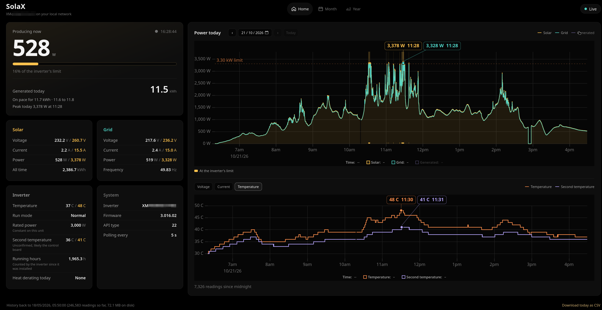
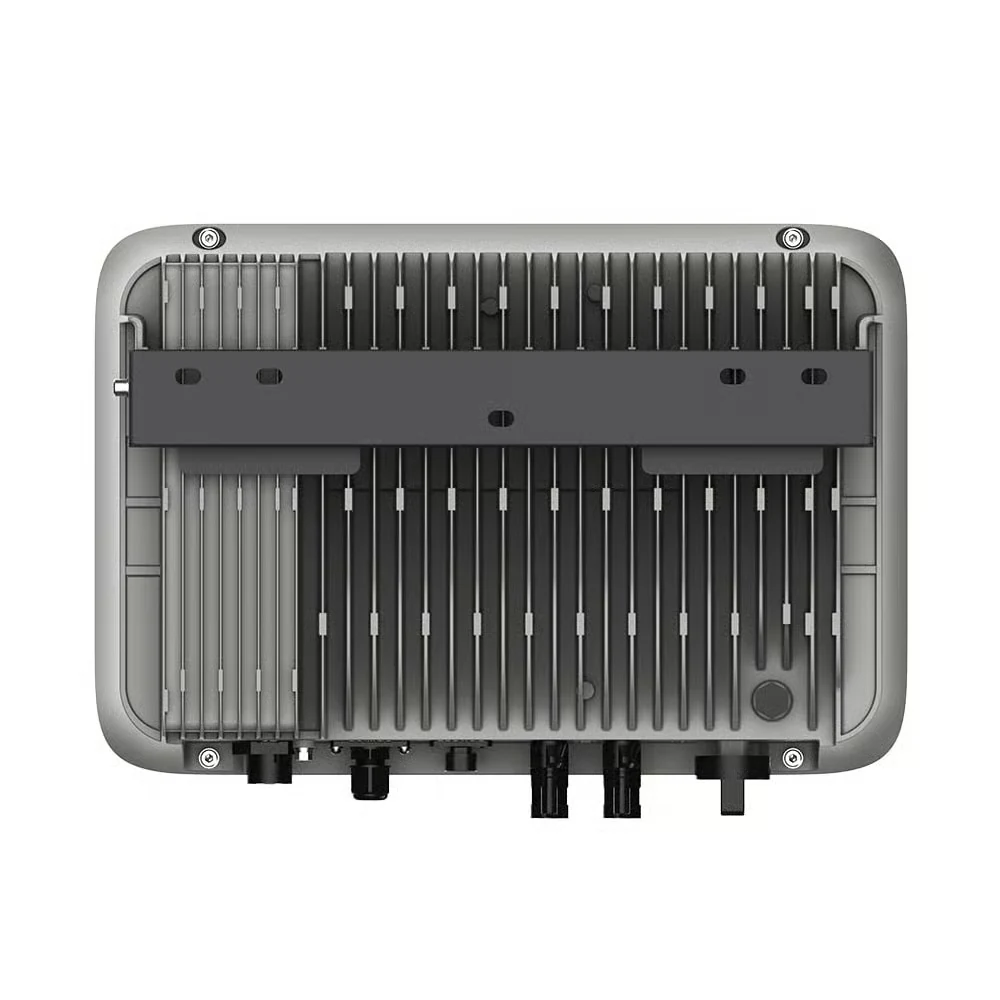
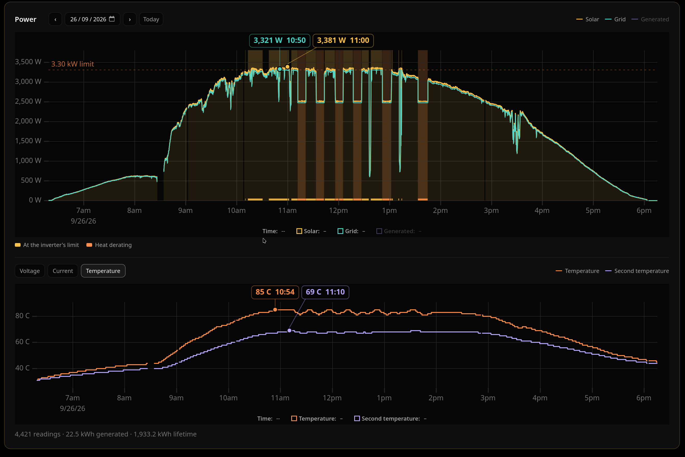
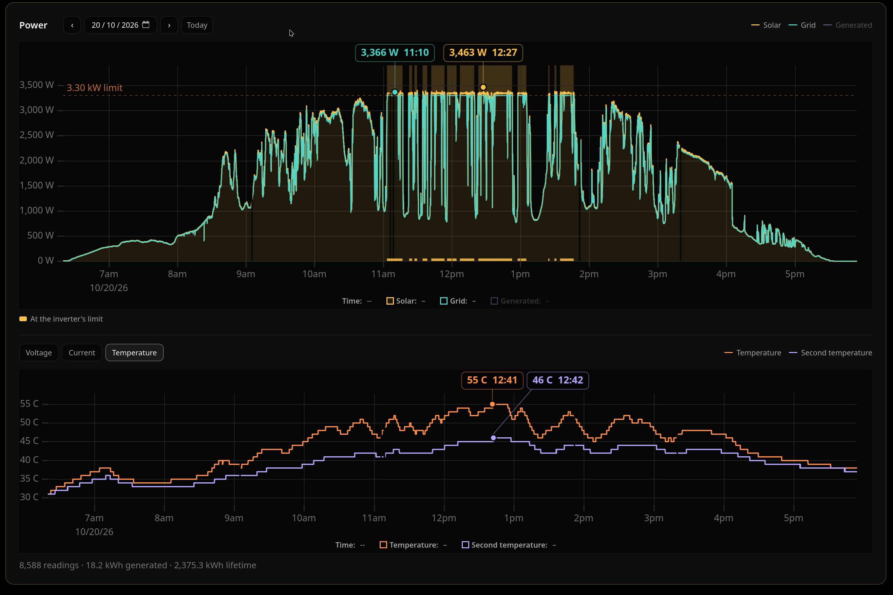

# solax-monitor

A self-hosted SolaX inverter monitor. It polls the inverter over the local network, stores readings in SQLite, and serves a web dashboard for live power, energy generation, and historical trends.



The project is organised as a Rust workspace with a server, shared API types, and a TypeScript frontend.

| Path | What it is |
|---|---|
| `server/` | The poller, SQLite store, `/api/v1`, and the built screens it serves |
| `crates/solax-api/` | The types sent over the wire, with the TypeScript generated from them in `bindings/` |
| `ui/` | The screens: Home, Month, and Year; built with TypeScript, Vite, and uPlot |

See [`server/README.md`](server/README.md) for server configuration, the metrics registry, polling behaviour, storage, and API details.

> [!IMPORTANT]
> This is tested with the **SolaX X1 Mini G4 inverter configured for a maximum output of 3.3KW**. Compatibility with other SolaX inverter models has not been verified.

### Thermal derating: from diagnosis to measurable results

By correlating live inverter telemetry with temperature and power output, I identified a thermal derating behaviour: at around **85°C, the inverter steps down to 75% of its configured maximum output**.

The inverter relies on a passively cooled, finned enclosure:



Rather than modifying the inverter's internals, I engineered an external active-cooling system using five high-speed DC fans: three top-mounted fans exhaust hot air, while two bottom-mounted fans, angled at 30° and 60°, direct airflow upwards.

**Observed results:**
- **Lower operating temperatures:** reduced from approximately 85°C and 69°C before cooling to maximum readings of 54°C and 45°C, respectively.
- **Sustained peak output:** maintains 3.3 kW instead of recurring midday drops to around 2.4 kW.
- **Low power overhead:** five fans drawing a maximum of 0.1 A at 230V AC, operating from 7 AM to 5 PM.
- **Estimated 15–20% increase in daily generation:** attributed to reducing thermal derating during peak production hours.

#### Before active cooling:


#### After active cooling


The monitoring system captures live telemetry and historical readings, making it possible to investigate the relationship between temperature and power output and evaluate the effects of the cooling intervention.

This project combines local protocol investigation, telemetry analysis, historical data engineering, and hands-on thermal engineering to diagnose a real-world hardware limitation and measure the impact of a practical solution.

## Running it

The live monitor runs from the image built by `Dockerfile`, which compiles the frontend and server together:

```sh
docker compose up -d --build
```

Create `server/config.toml` from `server/config.toml.example` and configure it for your inverter. The server also reads `server/metrics.toml` and stores its database in `solax-data/`, which must be writable by the user running the container.

## Developing

The server serves the frontend from `ui/dist`, so build it first:

```sh
cd ui && npm ci && npm run build
```

Then run the development server against a **copy** of the database:

```sh
cd server
mkdir -p data
cp /path/to/a/copy/of/solax.db data/
SOLAX_CONFIG=config.dev.toml cargo run
```

It listens on `http://127.0.0.1:8081/?token=change-me` and uses a development configuration that points to an address where the inverter is not expected to respond.

**Never point the development server at the live database.** Each server version reconciles the generated columns to its own metrics registry at start-up, and two servers must never run against the same database file.

While working on the frontend, run `npm run dev` in `ui/`. Vite serves the screens with live reloading and proxies API requests to the development server.

## Checks

Run the Rust workspace tests:

```sh
cargo test --workspace
```

Run the frontend checks and tests:

```sh
cd ui
npm run check
npm test
```

`cargo test` fails if the TypeScript bindings in `crates/solax-api/bindings/` are out of date. Regenerate them with:

```sh
cargo test -p solax-api -- --ignored write_bindings
```

Commit the regenerated bindings along with the Rust type changes.

See [`ui/e2e/README.md`](ui/e2e/README.md) for the end-to-end page check, which runs a real browser over every screen at six viewport sizes.

## License

Licensed under the GNU Affero General Public License v3.0 (AGPL-3.0-only). See [`LICENSE`](LICENSE).
